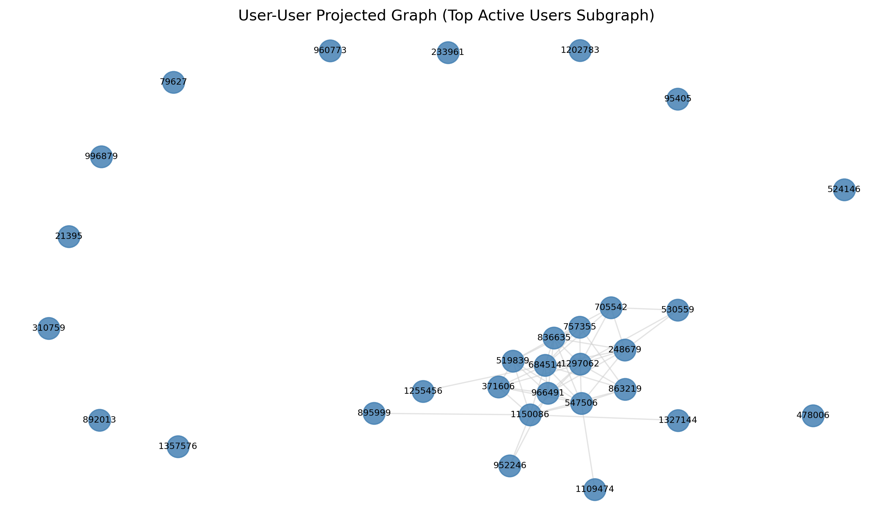
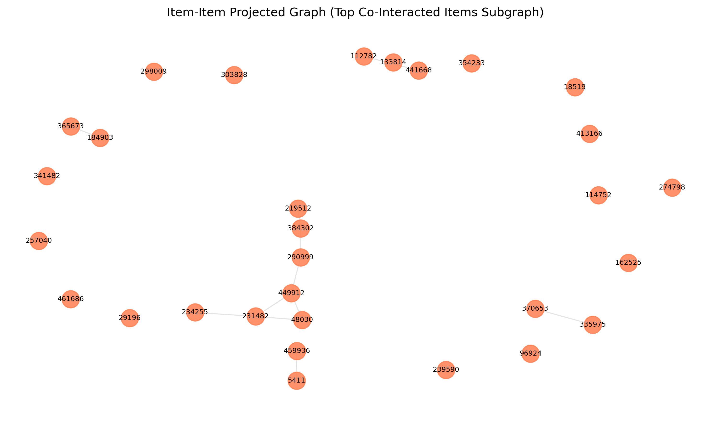
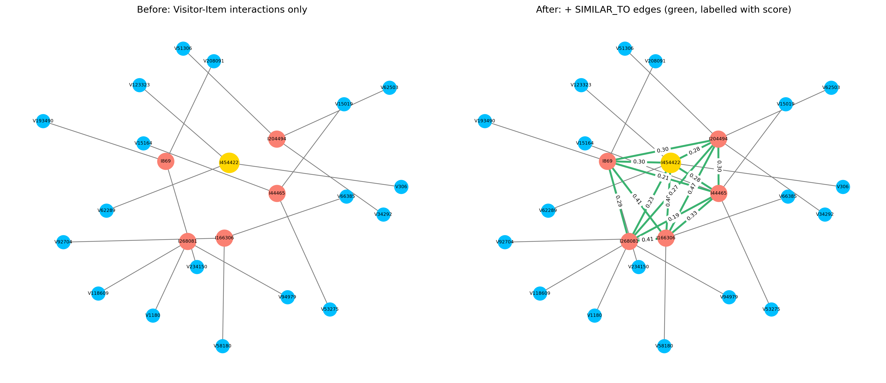

# Graph Data Science - Midterm Examination (UTS)

**Student Name:** Daffa Ahmad Pangreksa  
**Student ID (NIM):** 24031554159  
**Study Program:** S1 Sains Data, Universitas Negeri Surabaya  
**Course:** Graf Sains Data (Gasal 2026/2027)  
**Topic:** Neo4j Python Driver, Graph Modeling, Vector Space Modeling (VSM), and Recommendation Systems  

---

## Project Overview

This repository contains the end-to-end implementation for the Graph Data Science Midterm Examination. The project analyzes e-commerce user-item interactions from the RetailRocket dataset using **Neo4j**, **Vector Space Modeling (VSM)**, and **Item-based K-Nearest Neighbors (KNN)** collaborative filtering.

### Key Highlights:
- **Hybrid Runtime Compatibility:** Can be run on both **Google Colab** (with automated background Neo4j Community Server initialization) and **Local Workstations** (connecting to Neo4j Desktop via secure `getpass`).
- **Automated Artifact Archival:** All evaluation CSVs and NetworkX plots are bundled and exported automatically.

---

## Dataset & Fold Partitioning

The analysis operates on the **RetailRocket eCommerce Dataset** (`events.csv`). A unique, non-overlapping date partition was selected in accordance with course coordination:

| Fold | Start Date (UTC) | End Date (UTC) | Duration | Total Events | Unique Visitors | Unique Items |
| :--- | :--- | :--- | :--- | :--- | :--- | :--- |
| **P1 (Training)** | `2015-07-01 00:00:00` | `2015-07-10 23:59:59` | 10 Days | 195,503 | 114,687 | 67,926 |
| **P2 (Testing)**  | `2015-07-11 00:00:00` | `2015-07-18 23:59:59` | 8 Days | 159,579 | 94,930 | 58,110 |

---

## Visualizations

| User VSM Projection (Top Active Users) | Item VSM Projection (Top Co-Interacted Items) |
| :---: | :---: |
|  |  |

| Graph Topology Evolution (Before vs After Similarity Calculation) |
| :---: |
|  |

---

## Repository Structure

```text
├── UTS_GDS_159.ipynb            # Primary executed Jupyter Notebook (All 45 cells)
├── README.md                    # Project documentation and empirical summary
├── requirements.txt             # Python dependencies
├── .gitignore                   # Git ignore rules for environments, raw data, and archives
└── outputs/                     # Generated experimental outputs and figures
    ├── events_p1_train.csv
    ├── events_p2_test.csv
    ├── events_filtered_p1_p2.csv
    ├── summary_stats_p1_p2.csv
    ├── subgraph_nodes_composition.csv
    ├── subgraph_relationships_composition.csv
    ├── projection_comparison.csv
    ├── projection_size_full_graph.csv
    ├── top5_similar_items.csv
    ├── relationship_composition_before_after.csv
    ├── knn_recommendations.csv
    ├── ndcg_evaluation_table.csv
    ├── aggregate_evaluation_summary.csv
    ├── user_vsm_graph.png
    ├── item_vsm_graph.png
    └── graph_topology_before_after.png
```

---

## How to Run

### Option A: Google Colab (Zero-Setup Cloud Execution)
1. Upload `UTS_GDS_159.ipynb` to [Google Colab](https://colab.research.google.com).
2. Select **Runtime** $\to$ **Run all**.
3. The notebook will automatically:
   - Detect the Colab environment and install dependencies.
   - Download and start an internal Neo4j Community Server on port 7687 (Don't forget to input the password).
   - Download `events.csv`, run data filtering, graph ingestion, and evaluation.
   - Bundle all artifacts into `uts_gds_outputs.zip` and trigger an automated browser download.

### Option B: Local Workstation (Neo4j Desktop)
1. Clone the repository and install dependencies:
   ```bash
   python -m venv env
   # Windows:
   .\env\Scripts\activate
   # Linux/macOS:
   source env/bin/activate

   pip install -r requirements.txt
   ```
2. Start your local Neo4j DBMS in **Neo4j Desktop** (port `7687`).
3. Launch Jupyter:
   ```bash
   jupyter notebook UTS_GDS_159.ipynb
   ```
4. Run all cells. When prompted by `getpass`, enter your local Neo4j database password.